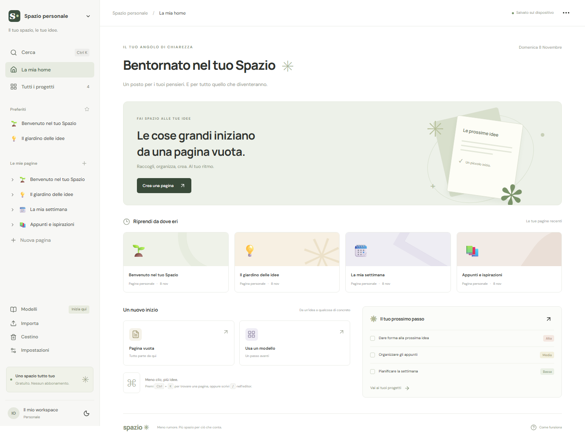

# CosmoMemo · Spazio

Uno spazio personale in italiano per scrivere, organizzare idee e seguire progetti. Ispirato al modello di pagine e blocchi di Notion, con un’interfaccia e un nome indipendenti.



Questa versione usa **Next.js standard** ed è pronta per essere importata su **Vercel**. Non richiede Cloudflare, Sites, credenziali ChatGPT, un database o chiavi API.

## Funzioni

- Pagine e sottopagine, icone, preferiti e ricerca nel testo.
- Editor con dieci tipi di blocco, menu `/`, riordino e duplicazione.
- Attività in tabella e bacheca, stato, priorità, scadenza, filtri e ordinamento.
- Modelli, cestino e ripristino, tema chiaro/scuro e layout responsivo.
- Salvataggio automatico nel browser, backup JSON e importazione senza sovrascrivere i dati presenti.
- Esportazione Markdown e importazione semplice di singoli file `.md`.

## Avvio locale

Richiede Node.js 22 e npm.

```bash
npm ci
npm run dev
```

Apri http://localhost:5173.

```bash
npm run build
npm run typecheck
npm start
```

## Pubblicazione su Vercel da GitHub

1. Su Vercel scegli **Add New → Project** e importa questa repository.
2. Seleziona **Next.js** come framework e lascia la directory principale su `.`.
3. Usa i comandi predefiniti: installazione `npm ci`, build `npm run build`. Lascia automatica la directory di output.
4. Non servono variabili d’ambiente. Avvia **Deploy**.

I successivi push sul branch di produzione attivano il rilascio tramite l’integrazione Git di Vercel. L’accessibilità del sito dipende dalle impostazioni di protezione del progetto Vercel: il codice non introduce un login applicativo. Ogni visitatore usa i propri dati locali.

Vedi anche la [guida ufficiale Vercel](https://vercel.com/docs/deployments).

## Trasferire i contenuti dalla versione Sites

1. Nel vecchio sito apri **Impostazioni → Backup completo → Esporta**.
2. Nel nuovo indirizzo Vercel apri **Impostazioni → Importa contenuti** e seleziona il file JSON.

Il trasferimento non è automatico: il salvataggio del browser appartiene all’indirizzo del sito. Conserva il file JSON come copia di sicurezza. L’importazione aggiunge copie dei contenuti; ripeterla produce duplicati.

## Dati e limiti

Pagine e attività restano nel localStorage del browser corrente e non vengono inviate a un server applicativo. Cancellare i dati del sito elimina il workspace. Non sono previste sincronizzazione tra dispositivi, collaborazione, allegati, AI, relazioni, formule, database personalizzabili o riapertura offline garantita. I font Google sono scaricati esternamente con fallback di sistema.

Non ci sono abbonamenti applicativi o API a pagamento per le funzioni implementate. Hosting, quote e condizioni dipendono dal piano Vercel scelto.

## Struttura e documentazione

- `app/page.tsx`: interfaccia, editor e gestione del workspace.
- `app/globals.css`: stile e layout responsivo.
- `lib/workspace.ts`: schema, validazione, contenuti iniziali ed esportazione.
- [RICERCA.md](RICERCA.md): ricerca originale e confronto delle funzionalità.
- [VERIFICHE.md](VERIFICHE.md): controlli sulla prima versione.
- GitHub Actions controlla build e TypeScript a ogni push e pull request.

Il progetto non è affiliato a Notion. Le dipendenze mantengono le rispettive licenze. La ricerca descrive anche la prima versione Vinext/Sites; questa distribuzione usa Next.js e non include gli strumenti di hosting di quel template.
